<div align="center">

# 🤖 agent-team-kit

**A four-agent team and a pixel-art side pane for [Claude Code](https://claude.com/claude-code).**<br>
Watch your agents work, tune each one's model and effort, and keep token use lean.

[](https://github.com/Dalibex/agent-team-kit/actions/workflows/ci.yml)
[](https://github.com/Dalibex/agent-team-kit/releases/latest)
[](LICENSE)



[🚀 Install](#-install) · [👥 The team](#-the-team) · [💻 The pane](#-the-pane) · [🎒 Skill packs](#-skill-packs) · [📜 Team rules](#-team-rules) · [🔧 Settings](#-settings) · [🔄 Update](#-update-and-uninstall) · [🧰 Development](#-development)

</div>

## ✨ Highlights

| | |
| --- | --- |
| 👥 **A real team** | Explorer, implementer, tester and reviewer, each with its own model, job and limits. |
| 👀 **See them work** | Pixel sprites wake up, work and finish with confetti; a violet **?** when one stops to ask. |
| 🪙 **Lean on tokens** | The explorer reads on Haiku, briefs carry their context, and the pane flags spawns that waste tokens. |
| 🎛️ **Yours to tune** | Pick each role's model (Haiku, Sonnet, Opus) and effort (low to max) from the pane. |
| 📊 **Usage at a glance** | 5-hour and weekly limits, when you will hit them at this pace, and the context window. |
| 🎒 **Skill packs** | Group skills into packs and pick them per project; Claude loads only what each request needs. |
| 🐙 **GitHub and builds** | Branch, PR checks, reviews waiting, and every install, build and test with its progress. |
| 🌍 **English or Spanish** | The whole pane in both languages. The pane itself calls no model and costs no tokens. |

## 🚀 Install

In Claude Code (the CLI, or the Code tab of the desktop app):

```
/plugin marketplace add Dalibex/agent-team-kit
/plugin install agent-team@agent-team-kit
```

Open a new session, or run `/reload-plugins`: the pane appears beside the
conversation with the team asleep. Then add the team rules to your
`CLAUDE.md`, so Claude delegates to the team:

```
/agent-team rules
```

> [!TIP]
> Try it: ask Claude to *"use the explorer to list the files in this folder"*
> and watch it wake up.

**Requirements:** Claude Code with plugin support. Optional, for the GitHub
tab: [GitHub CLI](https://cli.github.com/) signed in (`gh auth login`);
without it the tab still shows the local git state.

## 👥 The team

Four agents ship inside the plugin; Claude sees them as `agent-team:<name>`.

| | Agent | Model | Does |
| --- | --- | --- | --- |
| 🔦 | `explorer` | Haiku | Searches and reads code, never edits. Sent instead of Claude reading many files. |
| 🔨 | `implementer` | Sonnet | Makes an agreed change and verifies it with tests or a build. |
| 🧪 | `tester` | Sonnet | Writes and runs tests; reports bugs in production code instead of fixing them. |
| 🔍 | `reviewer` | Opus | Reviews a finished diff before a commit; the costliest, so only for non-trivial changes. |

- 📦 **Context in every brief.** The plugin appends the project folder, its
  branch and the skills you picked in the pane; each agent loads only the
  ones its task needs.
- ❓ **Questions go up, not sideways.** An agent that lacks something stops
  and answers `QUESTIONS:`. Claude continues that same agent with
  SendMessage, so it keeps what it already read, or asks you when the
  decision is yours. The pane shows it as asking, in violet, until it is
  continued.
- 🎛️ **Models and effort.** The Models block in the Team tab sets each
  role's model and effort, from the next agent on; "Reset" brings back the
  defaults. A model Claude names for one task still wins.
- 🤝 **Delegation.** Out of the box, Claude Code's Agent tool tells Claude
  not to delegate unless asked. The plugin replaces that paragraph with one
  that presents the team and points to your rules. The Delegate button in
  the Team tab turns it off, from the next conversation on.

<p align="center">
  
</p>

## 💻 The pane

The drawing shows Claude and its agents as pixel sprites: an agent sleeps
until it gets a task, works while it runs and finishes with confetti and a
sound of its own. Beside it, your usage limits: the 5-hour window with the
time it fills at the current pace, the weekly window and the session's
context, amber at 80 % and red at 95 %, with details on hover and a button
to compact the context. At its left, two switches mute the sounds (🔊/🔇)
and turn off system notifications (🔔/🔕); both are remembered.

<p align="center">
  
  
</p>

Under the drawing, one tab at a time; a hidden tab's button flags what is
happening in it, and the open tab is remembered.

| Tab | What it shows |
| --- | --- |
| 👥 **Team** | Two sections that fold. **Team**: the Delegate button and the Models block. **Team actions**: one row for Claude and one per agent with its task, time, model and the skills it loaded; unfolded, its brief, tokens and report. An agent that asked reads "asking (N)" and lists its questions. |
| 🎒 **Skills** | Your packs and loose skills ([below](#-skill-packs)). |
| ⚙️ **Jobs** | Installs, builds, tests and downloads with their time and, in the background, their real progress; a system notification when something long finishes. |
| 🐙 **GitHub** | The branch, uncommitted changes, the PR with its checks and a link to the failing one, PRs waiting for your review, links to the repository; a notice when the CI it was watching finishes. |
| 📊 **Usage** | Where the session's tokens go: input, output, cache, the context by category, each role's share, the heaviest tools and turns. |

> [!NOTE]
> **Rows flag waste:** a brief without Goal or Why, a repeated brief that
> could have continued an agent, an Opus review of a change of ten lines or
> fewer, and Claude reading more than five files without the explorer.

`/agent-team` hides or shows the pane. In a terminal the pane is drawn as
text.

## 🎒 Skill packs

Instead of typing `/skill` before each request, pick skills in the Skills
tab:

- **Packs**: twelve packs, each with a name you type and up to 24 skills.
  When a pack is picked, every request you send offers its skills to Claude,
  which loads only the ones the request needs.
- **Loose skills**: eight slots behind the "Loose skills" button; a picked
  one is loaded whole with every request.

Picks are remembered per project folder; packs and slots are the same
everywhere, and they stay on your machine. A skill that is no longer
installed is flagged and not sent. The Team tab shows which skills each
agent actually loaded, so you can tell whether a pack is too broad.

## 📜 Team rules

`/agent-team rules` adds the team rules to your global `CLAUDE.md`, and
`/agent-team rules off` removes them. Run it again after an update to bring
them up to date. The rules tell Claude:

- 🧭 when to use each agent: the explorer past five files, the implementer
  for agreed changes beyond a couple of edits, the tester after non-trivial
  changes, the reviewer before a non-trivial commit;
- 📝 the brief template: Goal, Why, Files, Done when, Limits;
- 🔁 to answer `QUESTIONS:` by continuing the same agent, and to check what
  each agent returns before accepting it.

<details>
<summary>Where the rules go and how the file is kept safe</summary>

The rules go in `~/.claude/CLAUDE.md` (or the folder in `CLAUDE_CONFIG_DIR`),
between `<!-- agent-team:reglas:inicio -->` and
`<!-- agent-team:reglas:fin -->`, leaving the rest of the file as it was and
keeping a copy of it first (`CLAUDE.md.agent-team-<time>.bak`, the last
five). It changes nothing, and tells you why, when the file is not UTF-8,
when the markers are broken, or when it finds an older team section without
markers (remove that one first). Type it yourself: it does not run from
another plugin or a message.

</details>

## 🔧 Settings

`/plugin configure agent-team@agent-team-kit`, or the plugin's settings in
the desktop app:

| Option | Values | Default |
| --- | --- | --- |
| `teamName` | Any name: "Ana" titles the pane "ANA TEAM" | empty: "AGENT TEAM" |
| `language` | `auto`, `en`, `es` | `auto`: Spanish when your system is in Spanish, English otherwise |
| `updateCheck` | `true`, `false` | `true`: once a day, ask GitHub for the latest release |
| `sessionLog` | `true`, `false` | `true`: when a session that used the team ends, write a summary of its agents to a file of its own in `agent-team/runs/` in the Claude config folder |

## 🔄 Update and uninstall

The pane tells you when a new version is out, with an **Update now**
button; typing `/agent-team update` does the same. Both ask GitHub for the
latest release and, only when it is newer than yours, run the two commands
below; then they run `/reload-plugins` when your session offers it, or tell
you to run it. To update by hand, in a terminal:

```bash
claude plugin marketplace update agent-team-kit
claude plugin update agent-team@agent-team-kit
```

then run `/reload-plugins` in Claude Code, or open a new session. You can
also enable auto-update for the `agent-team-kit` marketplace in `/plugin` →
Marketplaces.

To uninstall, run `/agent-team rules off` first if you added the rules,
then:

```
/plugin uninstall agent-team@agent-team-kit
/plugin marketplace remove agent-team-kit
```

## 🩺 Troubleshooting

| Problem | Fix |
| --- | --- |
| No pane | Open a new session; `/agent-team` shows it if it was hidden. |
| Two panes | Another copy of agent-team is enabled; keep one in `/plugin`. |
| The GitHub tab says `gh` does not answer | Install GitHub CLI and run `gh auth login`. |
| Claude does not delegate | Check that the rules are in your `CLAUDE.md` (`/agent-team rules`) and that Delegate is on in the Team tab. |

## 🧰 Development

```text
.claude-plugin/marketplace.json   the marketplace /plugin reads
plugin/agent-team/                the plugin
  hooks/                          register.tsx (events), pane.tsx (UI), state.ts (pure logic),
                                  actions.ts (side effects), i18n.ts (English and Spanish),
                                  drawing.ts, look.ts, usage.ts, jobs.ts, github.ts
  agents/                         the four agents
  tests/                          the test suite
docs/images/                      the README's pictures, drawn by scripts/readme-images/
```

```bash
claude plugin test plugin/agent-team
claude plugin validate plugin/agent-team
claude plugin validate .
```

The pictures come from the plugin's own drawing code, so redraw them when
the drawing changes: `node --import ./scripts/readme-images/register.mjs
scripts/readme-images/draw.mjs` writes the SVG scenes, and
`scripts/readme-images/png.ps1` (Windows, Edge or Chrome) the 1280×640
social preview.

The plugin's own [README](plugin/agent-team/README.md) explains its design
and the engine rules every module must follow. See
[CONTRIBUTING.md](CONTRIBUTING.md) for branches, commits, pull requests and
releases, and [SECURITY.md](SECURITY.md) to report a vulnerability.

## 📄 License

[MIT](LICENSE).
